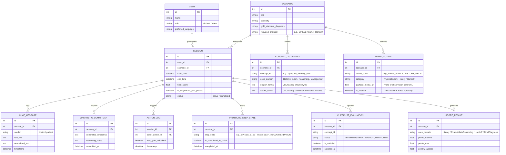
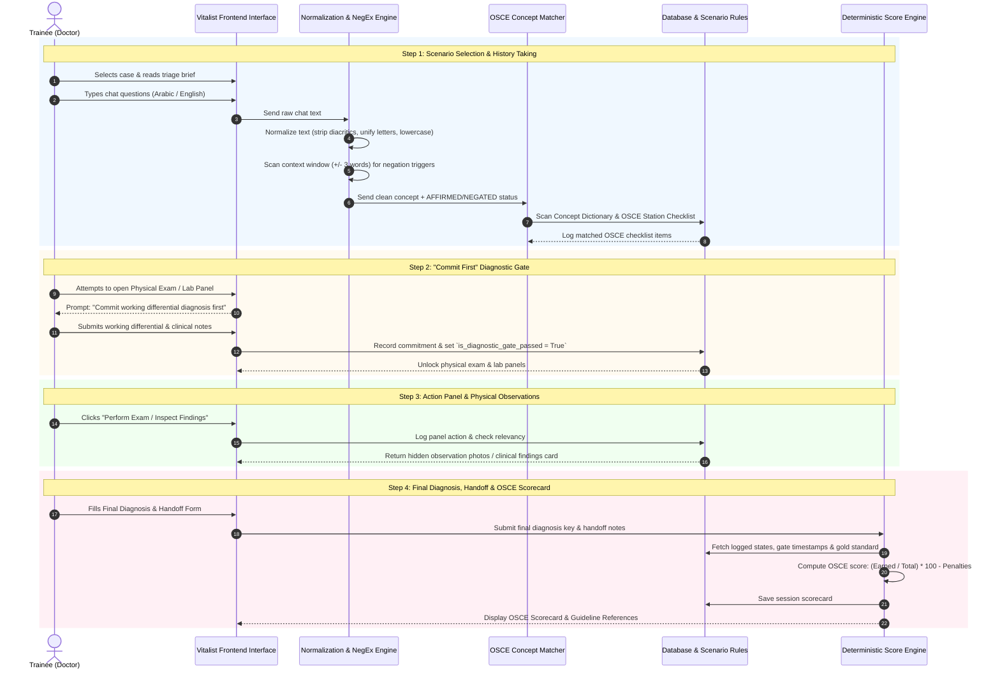

# VITALIST: Master Technical Specification & System Blueprint

> **Version:** 1.0.0  
> **Target Audience:** AI Developer Agents & Software Engineering Teams  
> **Project Name:** Vitalist  
> **Description:** A deterministic, bilingual (English and Arabic) clinical simulation and OSCE evaluation platform for medical students and interns.

---

## 1. System Overview & Core Philosophy

**Vitalist** provides medical students and interns with realistic hospital encounter simulations. Unlike traditional LLM-based applications that rely on unpredictable AI grading, Vitalist implements a **100% deterministic evaluation engine based on objective OSCE (Objective Structured Clinical Examination) standards**. 

* **The AI's Role:** Strictly limited to acting as the dynamic patient persona via constrained system prompts. It has zero participation in scoring or grading.
* **The Engine's Role:** Evaluates trainee inputs using concept dictionaries, text normalization, window-scanning negation detection, protocol order checking, and rule-based diagnostic gates.

---

## 2. UI Color Palette & Design Tokens

Vitalist uses a specialized 7-color teal/mint palette optimized for low-fatigue clinical software interfaces:

```css
:root {
  --color-dark-surface: #04222B;  /* App Header, Sidebar & Modal Backdrops */
  --color-card-surface: #0A3D4A;  /* Containers, Panels & Dark Borders */
  --color-muted-teal:   #10606F;  /* Secondary Buttons, Table Headers, Muted Badges */
  --color-primary-brand:#1D8B94;  /* Primary CTA Buttons, Active Tabs & Key Interactive Elements */
  --color-accent-teal:  #4FB8B4;  /* Highlighting, Status Badges & Progress Indicators */
  --color-mint-light:   #98D8D0;  /* Hover States, Success Icons & Section Headlines */
  --color-canvas-light: #E2F4F0;  /* Workspace Background, Text Surfaces & Light Cards */
}
```

---

## 3. Database Schema (Entity-Relationship Blueprint)



---

## 4. System Architecture & Data Flow (DFD Level 1)

```
[ Trainee ] ───┬──► (1.0 Free-Text Chat) ──────────► [ 2.0 Bilingual Normalizer ]
               │                                                  │
               │                                                  ▼
               │                                     [ 3.0 NegEx Negation Window ]
               │                                                  │
               │                                                  ▼
               │                                     [ 4.0 Concept & OSCE Matcher ] ──┐
               │                                                                      │
               ├──► (5.0 Working Differential) ───► [ 6.0 Diagnostic Gate Engine ] ────┤
               │                                                                      │
               ├──► (7.0 Action Button Click) ────► [ 8.0 Action & Panel Engine ] ────┼──► [ 10.0 Automated OSCE ]
               │                                                                      │    [    Scoring Engine   ]
               └──► (9.0 Final Handoff Form) ─────► [ Gold Standard Key Comparison ] ─┘            │
                                                                                                     ▼
                                                                                          [ Score & OSCE Report ]
```

---

## 5. Core Engine Specifications

### A. Bilingual Normalization Layer
Before keyword matching, input text passes through cleaning functions:
* **Arabic Normalization:** Strip diacritics (*Tashkeel*), remove elongation (*Tatweel*), unify Alef forms (`أ`, `إ`, `آ` $\rightarrow$ `ا`), and unify Ta Marbuta (`ة` $\rightarrow$ `ه`).
* **English Normalization:** Convert characters to lowercase, strip punctuation, and tokenize.

### B. Negation Handling Algorithm (NegEx Window Scan)
When a concept keyword is identified, the backend scans a surrounding context window ($\pm 3$ tokens) for negation markers:
* **English Negation Triggers:** `["no", "not", "denies", "without", "never", "free of", "absent"]`
* **Arabic Negation Triggers:** `["لا", "ليس", "ليست", "بدون", "ينفي", "تنفي", "عدم", "غير", "ما عنده", "بلا"]`
* **Evaluation Output:** `AFFIRMED` (positive credit), `NEGATED` (credit if ruling out is required), or `NOT_MENTIONED`.

### C. "Commit First" Diagnostic Gate
* **Enforcement:** Trainees cannot open physical exam or diagnostic test panels until they submit their working differential and reasoning in a modal form.
* **Logging:** Stores differential data in `DIAGNOSTIC_COMMITMENT` and sets `is_diagnostic_gate_passed = TRUE`.

---

## 6. Automated OSCE Scoring Rubric

$$\text{Final OSCE Score} = \left( \frac{\sum \text{Earned OSCE Points}}{\text{Total Station Points}} \times 100 \right) - \text{Safety Penalties}$$

| OSCE Domain | Weight (%) | Trigger Method | Deterministic Evaluation Mechanism |
| :--- | :--- | :--- | :--- |
| **History Taking & Communication** | 25% | Chat Input | Concept matching + NegEx window scan for symptoms, onset, ADL impact, rule-outs, and communication protocol order (e.g., SPIKES). |
| **Diagnostic Gate Reasoning** | 15% | Modal Form | Evaluates whether valid differential hypotheses were committed *prior* to unlocking physical exams or lab panels. |
| **Physical Exam & Observations** | 20% | Action Panel | Rewards selecting relevant physical examination buttons and identifying findings in revealed photos/observation cards. |
| **Final Diagnosis Accuracy** | 25% | Final Form | Direct string/key match against scenario's gold-standard primary diagnosis. |
| **Handoff & Disposition** | 15% | Final Form | Evaluates post-encounter disposition (admission unit, night nurse watch-list warnings) against case rubric. |
| **Safety & Harmful Actions** | -5% to 0% | Action Panel | Deducts points for ordering contraindicated tests, invasive unnecessary procedures, or harmful medications. |

---

## 7. User Journey & Navigation Sequence



---

## 8. Implementation Guidelines for AI Builders

1. **Single-File or Modular React Architecture:** Build components using Tailwind CSS and the exact hex tokens provided in Section 2.
2. **State Isolation:** Ensure the Patient AI prompt state is strictly separated from the evaluation reducer/scoring functions.
3. **Strict Determinism:** Never use probabilistic LLM scoring for checklists. All evaluations must pass through the `CONCEPT_DICTIONARY`, `NegEx` window scan, and OSCE rubric formulas.